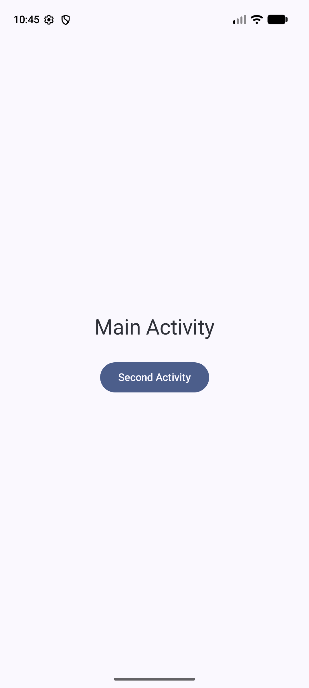
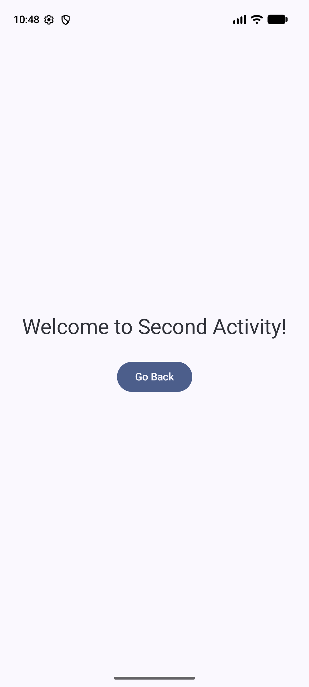

# Android Navigation Assignment

A simple Android application built using **Kotlin** and **Jetpack Compose** demonstrating screen navigation between two activities (`MainActivity` and `SecondActivity`) using **Explicit Intents** and button click handlers.

## 📱 Screenshots

| Main Activity | Second Activity |
| :---: | :---: |
|  |  |

## 📌 Features
- **MainActivity**: Displays a screen with a button labeled **"Second Activity"**.
- **Explicit Intent Navigation**: Clicking the button navigates to `SecondActivity`.
- **SecondActivity**: Displays a welcome message and a **"Go Back"** button.
- **Activity Lifecycle Handling**: The "Go Back" button closes `SecondActivity` using `finish()`, returning the user to `MainActivity`.

## 🛠️ Built With
- **Language**: Kotlin
- **UI Framework**: Jetpack Compose (Material 3)
- **Architecture**: Android Activities & Explicit Intents
- **IDE**: Android Studio

## 🚀 How to Run
1. Clone this repository:
   ```bash
   git clone https://github.com/ChaninduImanjith/android-navigation.git
   ```
2. Open the project in **Android Studio**.
3. Sync Gradle and run the app on an Android Emulator or physical device.

## 📝 Learning Objectives
- Understanding Android Activities and how they represent app screens.
- Handling button clicks in Jetpack Compose.
- Using Explicit Intents to pass control between Activities.
- Declaring Activities in `AndroidManifest.xml`.
